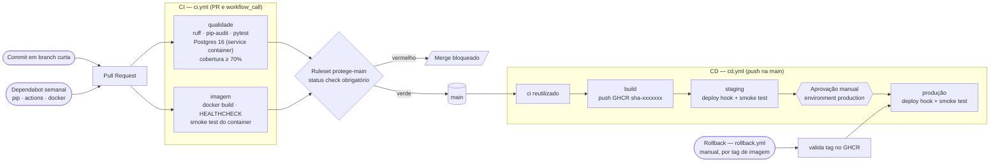
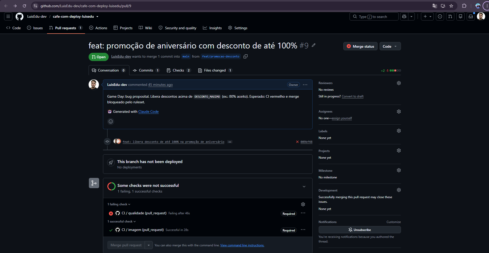
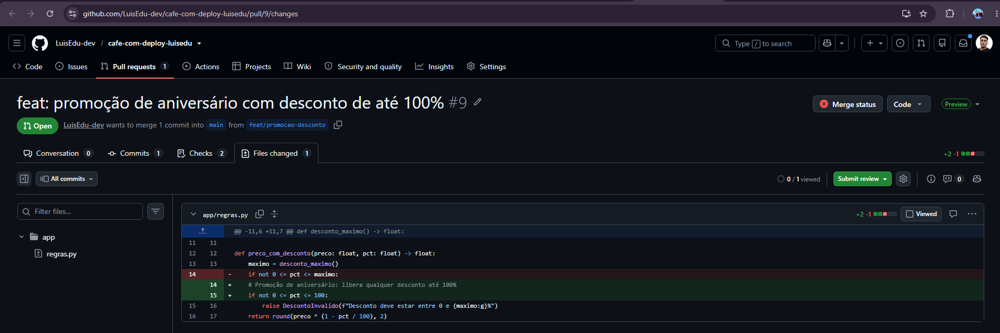
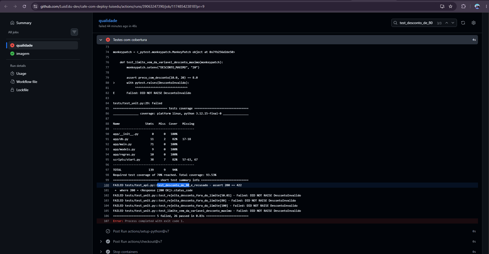
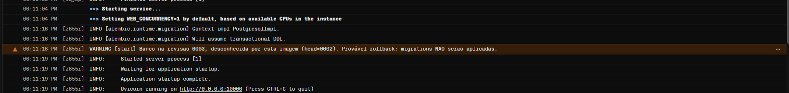
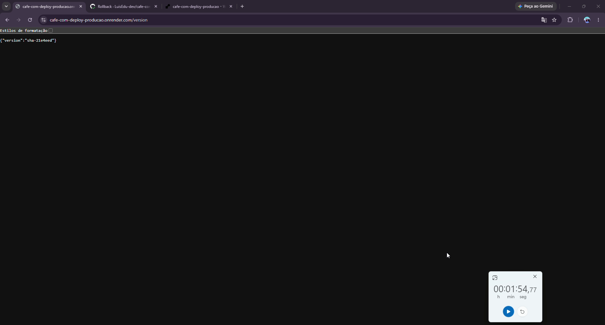
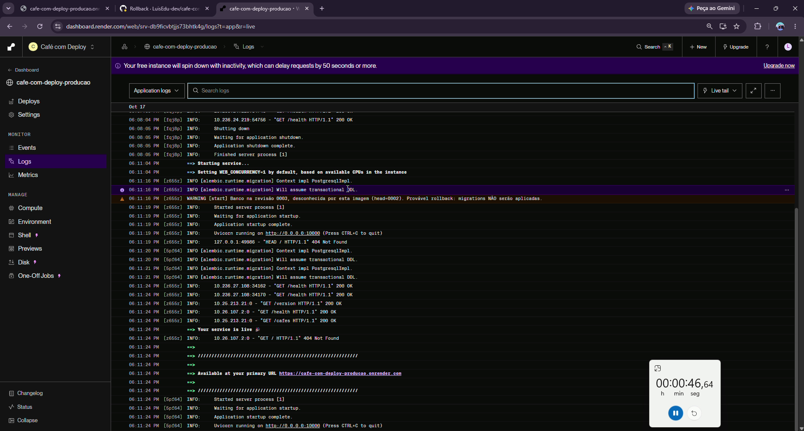

# ☕ Café com Deploy — Relatório de Voo

API da startup fictícia **Café com Deploy**, reconstruída com pipeline completo de CI/CD.
Atividade de Sistematização — *Integração e Entrega Contínuas* (Pós CEUB).

## 1. Status e ambientes

[](https://github.com/LuisEdu-dev/cafe-com-deploy-luisedu/actions/workflows/cd.yml)
[](https://github.com/LuisEdu-dev/cafe-com-deploy-luisedu/actions/workflows/rollback.yml)
[](https://github.com/LuisEdu-dev/cafe-com-deploy-luisedu/releases/tag/v1.0.0)


| Ambiente | URL | Versão | Observação |
|---|---|---|---|
| Staging | https://cafe-com-deploy-staging.onrender.com | [/version](https://cafe-com-deploy-staging.onrender.com/version) | `FEATURE_CARDAPIO_ORIGEM=true` |
| Produção | https://cafe-com-deploy-producao.onrender.com | [/version](https://cafe-com-deploy-producao.onrender.com/version) | `FEATURE_CARDAPIO_ORIGEM=false`, deploy só com aprovação |
| Imagem | `ghcr.io/luisedu-dev/cafe-com-deploy-luisedu` | tag `sha-<commit>` | pacote público no GHCR |
| Release | [v1.0.0 — primeiro deploy em produção](https://github.com/LuisEdu-dev/cafe-com-deploy-luisedu/releases/tag/v1.0.0) | `sha-21e4eed` | |

> O plano gratuito do Render hiberna o serviço: a primeira requisição pode levar ~50 s.

Endpoints: `GET /health`, `GET /version`, `GET /cafes`, `POST /cafes`, `GET /cafes/{id}`,
`GET /cafes/{id}/preco?desconto=10` (desconto entre 0 e `DESCONTO_MAXIMO`, padrão 50; fora disso → **422**).

## 2. Arquitetura do pipeline



- **`deploy.yml` reutilizável:** staging, produção e rollback usam o mesmo job. Ele chama o deploy hook do Render com `?imgURL=` apontando para uma tag já publicada e só passa quando `/version` devolve a versão esperada. O smoke test tenta 20 vezes, uma a cada 15 s, e também confere `/health` e `/cafes`.
- **Imagem imutável:** a imagem testada em staging é a mesma promovida para produção, com tag `sha-<commit>`. Nada é reconstruído entre os ambientes.
- **Segredos:** `RENDER_DEPLOY_HOOK` e `APP_URL` ficam em cada *environment* do GitHub e chegam aos passos por `env:`, nunca interpolados dentro de `run:`. O `DATABASE_URL` (Neon, um projeto por ambiente) existe só no Render.
- **Proteções:** `concurrency: cd-main` sem cancelamento (um deploy por vez, CD e rollback na mesma fila). `permissions` mínimas em todos os workflows. Ruleset `protege-main`: PR obrigatório, status check obrigatório, sem force-push e sem deleção.

## 3. Diagnóstico dos antipadrões

Os sete primeiros antipadrões vêm da tabela 3.1 do enunciado. Os três seguintes são do cenário da Café com Deploy. A fundamentação vem de Humble & Farley, *Entrega Contínua*, cujo capítulo 1 descreve os três primeiros antipadrões com esses nomes, e do *Twelve-Factor App* (12factor.net).

| # | Antipadrão | Prática adotada | Evidência no repositório | Fundamentação |
|---|---|---|---|---|
| 1 | Implantar manualmente (FTP, SSH, passo a passo no Word) | Pipeline disparado por merge | `cd.yml`: merge na main → CI → imagem no GHCR → staging → produção, sempre pelo mesmo `deploy.yml` | Humble & Farley: implantação manual é propensa a erro e não repetível; o processo deve ser automatizado e idêntico em todo ambiente. 12-Factor V (separar *build*, *release* e *run*) |
| 2 | Testar em ambiente parecido com produção só no final | Staging com a mesma imagem | Toda versão passa por staging (banco Neon próprio) com a **mesma** tag `sha-<commit>` que depois é promovida, sem rebuild | Humble & Farley: implantar em ambiente similar ao de produção desde cedo e a cada mudança. 12-Factor X (paridade entre desenvolvimento e produção) |
| 3 | Configuração de ambientes à mão | Variáveis de ambiente + GitHub Environments | `APP_URL` e `RENDER_DEPLOY_HOOK` por *environment*; `DATABASE_URL`, `DESCONTO_MAXIMO` e `FEATURE_CARDAPIO_ORIGEM` lidos do ambiente | Humble & Farley: a configuração de produção deve ser gerenciada e versionada, não ajustada à mão. 12-Factor III (configuração no ambiente) |
| 4 | "Funciona na minha máquina" | Container Docker reprodutível | `Dockerfile` multi-stage, usuário não-root e `HEALTHCHECK`; o CI constrói e testa o container em todo PR; `docker-compose.yml` para rodar localmente | Humble & Farley: o mesmo binário do commit até produção. 12-Factor II (dependências declaradas e isoladas) e X |
| 5 | `ALTER TABLE` manual em produção | Migrations versionadas pelo pipeline | 3 migrations Alembic testadas do zero no CI e aplicadas pelo `scripts/start.py` ao subir o container (seção 5) | Humble & Farley, cap. 12 (gerência de dados): mudanças de banco versionadas, automatizadas e retrocompatíveis. 12-Factor XII (tarefas administrativas com o mesmo código da release) |
| 6 | Senha do banco no código | Secrets do GitHub + `.env` no `.gitignore` | Só `.env.example` sem segredos versionado; segredos em *environments* e no Render; passados aos passos por `env:` | 12-Factor III: credenciais nunca no código. Humble & Farley: nada de senhas no controle de versão |
| 7 | Dependências "na última versão" | Versões fixadas + Dependabot + pip-audit | `requirements*.txt` com `==`, `pip-audit` no CI, Dependabot semanal (pip, Actions, Docker); PR #7 avaliado e fechado com justificativa | 12-Factor II: declarar todas as dependências de forma explícita. Humble & Farley: builds reproduzíveis exigem dependências fixadas |
| 8 | Sem registro da versão que está rodando | `/version` + tag `sha` | `GET /version` devolve `sha-<commit>` (via `APP_VERSION` no build); o smoke test só passa quando a versão no ar é a esperada | Humble & Farley: rastreabilidade de cada binário até o commit que o gerou. 12-Factor V (cada release tem um identificador único) |
| 9 | Sem rollback | Workflow de rollback | `rollback.yml` volta para qualquer tag do GHCR: **1 min 54 s** no Game Day, com o banco à frente da imagem (seção 5) | Humble & Farley: ter um plano de rollback testado é pré-requisito para implantar com frequência. 12-Factor V (releases imutáveis permitem voltar) |
| 10 | Deploy de uma pessoa só, sem revisão | PR obrigatório + CI + aprovação manual | Ruleset `protege-main` com check `qualidade` obrigatório (o PR #9 foi bloqueado); environment `production` com *required reviewer* | Humble & Farley: o pipeline de implantação como única rota para produção, com *gates* visíveis e auditáveis |

## 4. Estratégia de testes

**31 testes, todos passando, com cobertura de 93,53%.** O mínimo exigido é 70% (`--cov-fail-under=70`). No CI, eles rodam contra **Postgres 16 em service container**. Na máquina local, sem `TEST_DATABASE_URL`, caem para SQLite em arquivo temporário. Nenhum teste aponta para o banco de produção.

| Camada | Arquivo | Testes | O que garante |
|---|---|---|---|
| Unitária | `tests/test_unit.py` | 9 | Regra `preco_com_desconto`: valores válidos, limites (−1, 50.01, 80, 100) e `DESCONTO_MAXIMO` lido do ambiente |
| Integração (API + banco) | `tests/test_api.py` | 14 | Rotas `/health`, `/version`, CRUD de cafés, 404/409/422, desconto via HTTP, feature flag ligada e desligada |
| Banco e migrations | `tests/test_db.py` | 6 | As 3 migrations aplicam do zero e revertem, nome único, preço como `float`, Migration 3 compatível com o código antigo |
| Entrypoint | `tests/test_start.py` | 2 | `start.py` migra banco atrasado e **não** migra banco à frente da imagem (cenário de rollback) |

| Módulo | Cobertura |
|---|---|
| `app/main.py`, `app/regras.py`, `app/models.py` | 100% |
| `app/db.py`, `scripts/start.py` | 82% (o que falta é o caminho de produção: conexão real e `uvicorn.run`) |

Além dos testes, o job `qualidade` roda `ruff check`, `ruff format --check` e `pip-audit`. Em PRs, o job `imagem` constrói o Dockerfile, espera o `HEALTHCHECK` ficar `healthy` e faz um smoke test no container.

### Game Day: o bug que não passou

O PR [#9](https://github.com/LuisEdu-dev/cafe-com-deploy-luisedu/pull/9) introduziu de propósito o bug "desconto de 80% aceito": uma "promoção" trocava o limite `DESCONTO_MAXIMO` por 100 fixo no código (commit [`009bf48`](https://github.com/LuisEdu-dev/cafe-com-deploy-luisedu/commit/009bf48)).

- **Resultado:** **5 testes falharam e 26 passaram.** O check `qualidade` ficou vermelho e o ruleset **bloqueou o merge**. O bug nunca chegou a staging nem à produção.
- **Correção:** feita no mesmo PR com `fix: restaura o limite de DESCONTO_MAXIMO no desconto` ([`736a859`](https://github.com/LuisEdu-dev/cafe-com-deploy-luisedu/commit/736a859)). O CI ficou verde com 31/31 testes, o merge foi feito e a versão `sha-ab3c88b` passou por staging e foi aprovada para produção.

| PR bloqueado | Diff do bug |
|---|---|
|  |  |



## 5. Migrations e expand/contract

| # | Arquivo | O que faz |
|---|---|---|
| 1 | `0001_cria_tabela_cafes.py` | Cria `cafes` (id, `nome` String(80) único, `preco` Numeric(6,2)) |
| 2 | `0002_seed_cafes.py` | Seed via `op.bulk_insert` com o cardápio de Brasília: Espresso Esplanada, Coado do Cerrado, Cappuccino Catedral, Latte Lago Paranoá, Mocha Memorial JK… |
| 3 | `0003_adiciona_coluna_origem.py` | Adiciona `origem` String(60) `NOT NULL` com `server_default='Cerrado Mineiro'` |

O container aplica as migrations ao subir, pelo `scripts/start.py`. `migrations/env.py` lê `DATABASE_URL` do ambiente e usa `Base.metadata`.

### Migration 3: criada depois do primeiro deploy, em fase *expand*

A Migration 3 foi escrita só **depois** da `v1.0.0` estar em produção (PR [#8](https://github.com/LuisEdu-dev/cafe-com-deploy-luisedu/pull/8)), simulando a evolução de um banco que já tem dados reais. Ela segue a fase **expand** do padrão *expandir/contrair*:

1. **Expand (feito):** a coluna nasce com `server_default`. As linhas existentes são preenchidas e o código antigo, que não conhece `origem`, continua inserindo cafés sem erro. O teste `test_migration_3_preserva_compatibilidade_com_codigo_antigo` comprova isso.
2. **Migrate (feito):** o código novo passa a ler e gravar `origem`. A exibição fica atrás da flag `FEATURE_CARDAPIO_ORIGEM`, ligada em staging e desligada em produção.
3. **Contract (futuro):** só quando nenhuma versão em uso depender do schema antigo dá para remover `server_default` ou fazer mudanças destrutivas. Fazer isso junto com a expansão quebraria o rollback.

### Rollback × Alembic: a armadilha resolvida

Voltar para uma imagem anterior à Migration 3 deixa o banco na revisão `0003`, que essa imagem não conhece. Um `alembic upgrade head` ingênuo falharia com `Can't locate revision` e a API não subiria. O `scripts/start.py` lê a revisão atual do banco antes de migrar. Se ela não existe no diretório de scripts da imagem, o banco está **à frente** da imagem: o script registra um aviso, **não migra** e sobe o uvicorn normalmente. Isso só é seguro porque a Migration 3 é retrocompatível (expand).

**Comprovado em produção no Game Day.** O rollback para `sha-21e4eed` (anterior à Migration 3) registrou no Render:

```
WARNING [start] Banco na revisão 0003, desconhecida por esta imagem (head=0002). Provável rollback: migrations NÃO serão aplicadas.
```

| Indicador | Valor |
|---|---|
| Do *Run workflow* até `/version = sha-21e4eed` (cronômetro) | **1 min 54 s** |
| Duração do workflow Rollback ([run](https://github.com/LuisEdu-dev/cafe-com-deploy-luisedu/actions/runs/39069827312)) | 48 s |
| Dados em `/cafes` após o rollback | intactos |
| Volta para `sha-ab3c88b` ([run](https://github.com/LuisEdu-dev/cafe-com-deploy-luisedu/actions/runs/39071584236)) | 1 min 0 s |



| `/version` com o cronômetro em 1:54 | Logs do Render durante o rollback |
|---|---|
|  |  |

## 6. Métricas DORA

Calculadas a partir do histórico real do repositório pelo script [`tools/dora.py`](tools/dora.py), que consulta a API do GitHub via `gh api`:

```powershell
python tools/dora.py
```

| Métrica | Valor (17/10/2026) |
|---|---|
| Frequência de deploy | 3 deploys em produção pelo CD (`sha-21e4eed`, `sha-2f07e22`, `sha-ab3c88b`) em ~15 h |
| Lead time para mudanças | média **3h05min**, mediana **2h25min** (30 commits; mín. 21min24s, máx. 13h36min) |
| Taxa de falha de mudança | 1/3 (33%) pela definição do script. **Falhas reais: 0/3** |
| Tempo de restauração | mediana **53 s** no workflow (2 runs de Rollback); **1 min 54 s** de ponta a ponta no cronômetro |

Como o script calcula cada métrica:
- **Deploy:** um job `deploy (production)` do workflow CD na main concluído com sucesso.
- **Lead time:** tempo entre a autoria de cada commit (merges excluídos) e o deploy em produção que o levou ao ar.
- **Falha:** um deploy seguido de um run do workflow Rollback antes do próximo deploy.
- **Restauração:** duração dos runs do Rollback.

Como ler esses números:
- **Taxa de falha:** a única "falha" contada é o rollback **simulado** do Game Day sobre `sha-ab3c88b`, que estava saudável. O bug real do Game Day foi barrado no CI e nunca foi implantado. Por isso, falhas reais são zero.
- **Lead time:** o máximo de 13h36min é a Migration 3 esperando a aprovação manual de produção durante a noite. O *gate* humano é o maior componente do lead time, como discutido na seção 7.
- **Classificação:** os números estão na faixa *elite* do DORA (deploy sob demanda, lead time < 1 dia, restauração < 1 h). A amostra, porém, é pequena: 3 deploys em 1 dia de projeto.

## 7. Reflexão sobre implantação contínua

O pipeline faz **entrega contínua**, não **implantação contínua**. Todo merge na main gera uma imagem pronta e testada, que vai sozinha para staging. Produção exige um clique de aprovação. Essa diferença foi deliberada:

- **O que já permitiria implantação contínua:** o CI barra regressões de verdade (PR #9). A imagem é imutável e a mesma de staging. O smoke test valida versão, saúde e dados. O rollback leva menos de 2 minutos e as migrations são retrocompatíveis (expand), então voltar de versão não exige mexer no banco. A flag `FEATURE_CARDAPIO_ORIGEM` separa *deploy* de *release*: o código vai para produção desligado.
- **O que ainda falta:** monitoramento e alertas pós-deploy (hoje só existe o smoke test), rollback automático quando o smoke test de produção falha, testes de contrato ou de carga, e um ambiente que não hiberne. No Render free, a primeira requisição leva ~50 s, o que torna os smoke tests lentos e instáveis.
- **Custo do gate manual:** as métricas mostram que o maior atraso do lead time foi a espera pela aprovação (13h36min no pior caso). Com uma pessoa acumulando todos os papéis, a aprovação vira burocracia, não revisão. Num time real, o próximo passo seria trocar o gate por verificações automáticas em staging (testes E2E e análise de métricas) e implantar automaticamente nos horários de baixo risco.
- **Dependabot como exemplo de julgamento:** o PR [#7](https://github.com/LuisEdu-dev/cafe-com-deploy-luisedu/pull/7) (Python 3.12 → 3.14 na imagem) passou no CI, mas foi **fechado com justificativa**. Os testes rodam em 3.12, então o CI verde não validava o runtime 3.14. "CI verde" só vale para o que o CI realmente exercita. Para implantar continuamente, o pipeline precisa testar exatamente o que vai para produção.

## 8. Integrante e conquistas

| Integrante | Matrícula | GitHub | Papéis |
|---|---|---|---|
| Luis Eduardo Vieira Barros | 82601738 | [@LuisEdu-dev](https://github.com/LuisEdu-dev) | Release Manager, Guardião dos Testes, Eng. de Plataforma, DBA, Documentador (trabalho individual) |

Histórico de entregas, sempre por PR com CI verde e Conventional Commits:
- [#1](https://github.com/LuisEdu-dev/cafe-com-deploy-luisedu/pull/1) estrutura inicial
- [#2](https://github.com/LuisEdu-dev/cafe-com-deploy-luisedu/pull/2) CI
- [#3](https://github.com/LuisEdu-dev/cafe-com-deploy-luisedu/pull/3) API e migrations 1 e 2
- [#4](https://github.com/LuisEdu-dev/cafe-com-deploy-luisedu/pull/4) Docker
- [#5](https://github.com/LuisEdu-dev/cafe-com-deploy-luisedu/pull/5) e [#6](https://github.com/LuisEdu-dev/cafe-com-deploy-luisedu/pull/6) CD, rollback e Dependabot
- [#7](https://github.com/LuisEdu-dev/cafe-com-deploy-luisedu/pull/7) Dependabot, fechado com justificativa
- [#8](https://github.com/LuisEdu-dev/cafe-com-deploy-luisedu/pull/8) Migration 3
- [#9](https://github.com/LuisEdu-dev/cafe-com-deploy-luisedu/pull/9) Game Day

| Conquista | Evidência |
|---|---|
| 🐘 **Banco de verdade** | CI roda os testes contra Postgres 16 em service container (`ci.yml`, `TEST_DATABASE_URL`) |
| 🔀 **Interruptor** | Feature flag `FEATURE_CARDAPIO_ORIGEM`: ligada em staging (`/cafes` mostra `origem`), desligada em produção |
| 📊 **Painel DORA** | Métricas calculadas do histórico real por [`tools/dora.py`](tools/dora.py) (seção 6) |

**Próximo passo: Infra como código (conquista opcional, não feita).** Hoje os serviços do Render e os projetos Neon foram criados pelo painel. O próximo passo seria descrevê-los num `render.yaml` (Blueprint) com os dois serviços baseados em imagem e as variáveis não secretas, marcando os segredos com `sync: false`. Ficou de fora porque aplicar um Blueprint cria serviços novos, com URLs e deploy hooks novos. Às vésperas da entrega, isso exigiria refazer `APP_URL`, os secrets e os links deste relatório.

## Referências

- HUMBLE, Jez; FARLEY, David. *Entrega Contínua: como entregar software de forma rápida e confiável*. Porto Alegre: Bookman, 2014.
- WIGGINS, Adam. *The Twelve-Factor App*. Disponível em: https://12factor.net/pt_br/.
- FORSGREN, Nicole; HUMBLE, Jez; KIM, Gene. *Accelerate*. IT Revolution, 2018 (métricas DORA).

## Rodando localmente
```powershell
py -3.12 -m venv .venv
.\.venv\Scripts\Activate.ps1
pip install -r requirements-dev.txt
copy .env.example .env   # preencha os valores
pytest                   # sem TEST_DATABASE_URL, usa SQLite temporário
docker compose up        # opcional: API + Postgres 16
```
